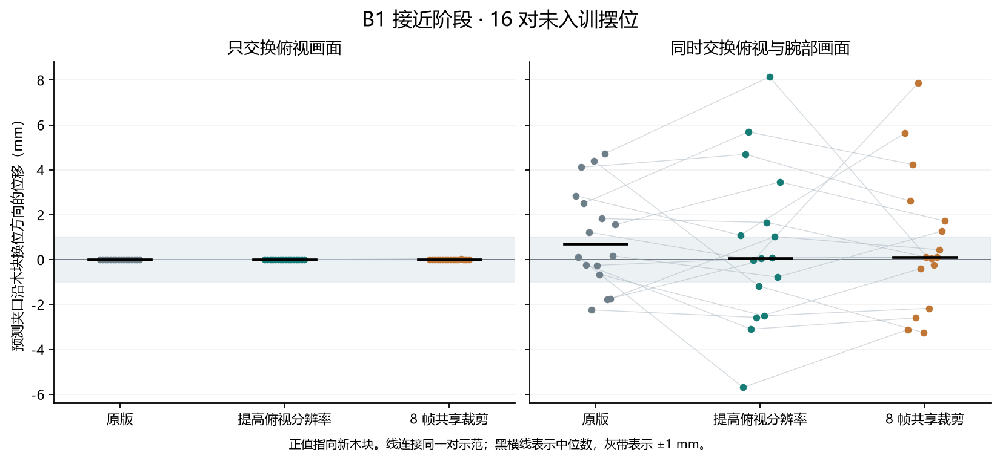

# B1 未入训摆位的夹口纠偏结果

2026 年 11 月 25 日完成两组独立对照。提高俯视分辨率、让同一段历史共享裁剪位置，都未使这版 B1 ODE 在接近时根据俯视木块位置作出毫米量级的纠偏。两组各自从同一种子训练 50 轮，均使用与原版相同的 50 条示范、9,731 行、15,250 次更新。已独立核对训练配置、全程样本数、归一化和三个最终 EMA 检查点的摘要。

## 换位时夹口动了多少

33 条未入训成功示范有完整的接近窗口，其中 32 条组成 16 对，木块间隔为 20.4–38.2 mm。在各对的两个方向分别固定接收方的反馈、上一条目标和腕部画面，只交换俯视画面，取八步后的预测夹口位置。下表的“有效正向”要求向新木块方向的两向平均位移超过 1 mm。“最大平面位移”取全部 32 次单向替换中的最大值，包含正向、反向和侧向分量。

| 训练条件 | 有效正向 | 最大平面位移 | 自身原始双相机画面下更接近木块 | 自然画面下距离缩短量中位数 |
|---|---:|---:|---:|---:|
| 原版，俯视 128 × 128 | 0/16 | <0.001 mm | 17/33 | +0.10 mm |
| 仅提高俯视分辨率至 256 × 256 | 0/16 | <0.001 mm | 15/33 | −0.80 mm |
| 仅让每个视角连续 8 帧共享裁剪位置 | 0/16 | 0.2645 mm | 15/33 | −0.62 mm |

在自然画面的同一阶段，专家实际目标有 19/33 条缩短了桌面平面距离，中位数为 +0.52 mm；部分接近动作主要沿竖直方向。负的距离缩短量表示八步后离木块更远。

只替换两个木块位置附近的局部俯视画面，三组的有效正向数也都是 0/16。把窗口移到收爪附近，或使用现场的混合分量采样方式、固定种子 42，整幅俯视图互换仍均为 0/16。在接近阶段同时换掉两个视角后，原版、高分辨率、共享裁剪组分别有 8、7、6 对超过 +1 mm，另有 3、5、4 对向反方向移动超过 1 mm。腕部输入发生变化时模型能改变动作，但方向仍不稳定。双视角替换也改变画面中机械臂的外观。

## 适用范围

计算桌面方向所用的映射只由训练示范拟合。在 33 条未入训示范上，图像估算的木块中心与专家实际夹持中心相距的中位数为 9.25 mm，90 分位为 21.32 mm。16 对中有 15 对的木块换位方向与专家实际夹持中心换位方向点积为正。表中的最大平面位移直接由两组关节预测做正运动学求得，不依赖木块映射。以上是单训练种子、八步离线回放下的结果；实机抓取成功率须另行测量。

这批证据支持保留当前示范用于下一步视觉诊断。优先在未入训画面上检验俯视编码能否定位木块和夹口，以及模型能否从相同起姿、不同摆位学出方向相反的修正。

[对照与评估协议](protocol.md) · [分组及逐对汇总](final.json) · [训练与独立复算凭据](audit.json)
